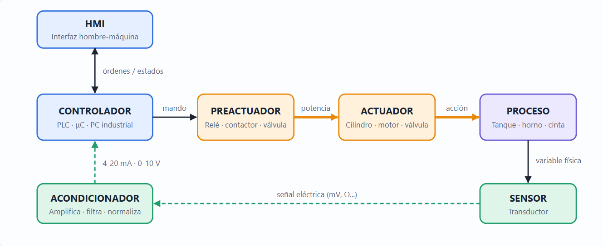

# Incubadora de codorniz

Proyecto de la materia **Automatización e Instrumentación**. Es una incubadora de huevos de codorniz que funciona como un sistema de automatización e instrumentación completo: se mide la temperatura, se acondiciona la señal, un controlador decide y un actuador calienta, mientras una interfaz web permite supervisar y configurar todo.

En el proyecto se implementan y se comparan diferentes métodos de control, y se trabaja todo el lazo de control, desde el sensor hasta la interfaz.

## Arquitectura del sistema



En esta incubadora cada bloque del diagrama es:
**Proceso** = la cámara de la incubadora · **Sensor** = transductor de temperatura · **Acondicionador** = amplificador del sensor · **Controlador** = Arduino · **Preactuador** = relé · **Actuador** = resistencia calefactora · **HMI** = interfaz web (USB, serie a 115200).

| Etapa | Qué es en este proyecto |
|---|---|
| **Variable de proceso (PV)** | Temperatura dentro de la incubadora, leída en `A1` |
| **Setpoint (SP)** | Temperatura objetivo (ideal ~37.5 °C). Se fija con un potenciómetro en `A0` o desde la interfaz |
| **Sensor y acondicionamiento** | Sensor de temperatura y amplificadores que adaptan su señal al rango del ADC del Arduino. La constante `ADCFS` indica cuántos °C representa el fondo de escala (1023) |
| **Controlador** | Arduino Uno con el firmware `incubadora.ino`. Promedia 8 lecturas para reducir ruido |
| **Preactuador** | Etapa de potencia del relé (pin `5`) |
| **Actuador** | Resistencia calefactora, accionada por el relé (pin `5`). Un LED en el pin `7` indica su estado. El ventilador (pin `6`) se enciende y apaga siempre junto con el relé |
| **Entradas de usuario** | Interruptores DIP (pines `3` y `4`) y botón (pin `2`) |
| **HMI** | Interfaz web (`web/`): lecturas, gráficas, configuración, consola serie |

### Métodos de control
- **Manual:** la resistencia se enciende y apaga a mano (interruptor DIP o botón de la interfaz).
- **Histéresis (on/off):** enciende por debajo de `SP − margen` y apaga por encima de `SP + margen`. El margen (`MARGIN`) es un % del setpoint.
- **PWM (proporcional):** el ciclo de trabajo es proporcional al error. Un error de `SPAN` grados da 100 % de salida, dentro de un periodo `PERIOD`.

La interfaz tiene una tabla que compara las tres técnicas, con un rango ± configurable alrededor del setpoint.

### Seguridad
- **Corte por sobretemperatura:** si la temperatura supera `TMAX` (40 °C por defecto), el firmware corta la resistencia en cualquier modo y la interfaz muestra una alarma.
- **Botón de emergencia (HMI):** el botón rojo **EMERGENCIA** de la barra superior envía `ESTOP 1`. El Arduino apaga la resistencia en cualquier modo (manual, histéresis o PWM) y la mantiene apagada aunque se cambie de técnica o de setpoint. La interfaz muestra una franja roja y el botón pasa a **Rearmar**; al pulsarlo se envía `ESTOP 0` y el control vuelve a funcionar. Reiniciar el Arduino también lo rearma, y la resistencia arranca apagada.

> **Importante:** este paro es **por software**. Solo funciona si el cable USB, el navegador y el Arduino están funcionando. No sustituye a un paro de emergencia real. Para una instalación con resistencia de red hay que añadir un **pulsador de emergencia físico** que corte la alimentación de la resistencia, independiente del Arduino.

---

## Requisitos

| Qué | Para qué |
|---|---|
| **Visual Studio Code** | Editor y entorno de ejecución |
| **Extensión PlatformIO IDE** (VS Code) | Compilar y subir el firmware al Arduino. Descarga sola el compilador y las librerías (`atmelavr`, `framework-arduino-avr`) |
| **Python 3.8+** | Lo necesita PlatformIO. Instálalo desde python.org marcando **Add to PATH** |
| **Chrome o Edge de escritorio** | La interfaz usa Web Serial, que no existe en Firefox ni Safari |
| **Arduino Uno + cable USB** | El controlador. En Windows puede hacer falta el driver CH340 si la placa es clon |
| **Conexión a internet** | Solo la primera vez, para que PlatformIO descargue lo que necesita. La interfaz usa fuentes de Google, pero funciona sin ellas |

No hay que instalar nada más: el firmware solo usa `EEPROM.h`, que viene con el framework de Arduino, y la web es HTML, CSS y JS puros, sin dependencias ni build.

## Instalación

1. **Instala VS Code** (code.visualstudio.com) y **Python**.
2. En VS Code abre Extensiones (`Ctrl+Shift+X`), busca **PlatformIO IDE** e instálala.
3. Espera a que termine. La primera vez descarga el núcleo de PlatformIO y puede tardar varios minutos. Después ejecuta `Ctrl+Shift+P` → **Developer: Reload Window**.
4. Abre la carpeta `incubadora` con **File → Open Folder**. PlatformIO detecta el `platformio.ini` y descarga la plataforma AVR al compilar por primera vez.

Si sale "Could not start PIO Home server" o "command 'platformio-ide.build' not found", PlatformIO no terminó de instalarse. Espera unos minutos y recarga la ventana. Si sigue igual, comprueba `python --version` o borra `C:\Users\<usuario>\.platformio` y reabre VS Code.

## Ejecución

### 1. Subir el firmware al Arduino
1. Conecta el Arduino por USB.
2. **Cierra el Monitor Serie** del Arduino IDE o de PlatformIO si está abierto: ocupa el puerto.
3. Elige el entorno en la barra inferior de VS Code (junto al icono de la casa de PlatformIO) y pulsa **→ Upload**. También se puede por terminal:
   ```
   pio run -e incubadora -t upload
   ```
   Sin `-t upload` solo compila.
4. Si no detecta el puerto, descomenta `upload_port` en `platformio.ini` y pon el tuyo (por ejemplo `COM3`).

### 2. Abrir la interfaz (HMI)
1. Abre `web/index.html` en **Chrome o Edge**. No necesita servidor. Con la extensión **Live Server** de VS Code también funciona: clic derecho en el archivo → *Open with Live Server*. Si tu navegador predeterminado es otro, copia la URL en Chrome o Edge.
2. Pulsa **Conectar**, elige el puerto del Arduino y deja los baudios en **115200**.
3. El bloque **Prueba de conexión** del panel envía `GET`, mide cuánto tarda la respuesta y se oculta al verificar la conexión. Si no hay Arduino, el botón **Demo** simula la incubadora.

Un solo programa puede usar el puerto a la vez: no uses la web y un monitor serie al mismo tiempo.

---

## firmware

Todo el código del Arduino está en `firmware/`. Cada sketch tiene su propio `setup()` y `loop()`, así que no pueden compilarse juntos. Por eso hay un entorno de PlatformIO por sketch:

| Entorno | Archivo | Qué hace |
|---|---|---|
| `incubadora` | `firmware/incubadora.ino` | Firmware real. Control de temperatura, telemetría `T,...` y comandos por serie (`GET`, `SET`, `SAVE`, `DEFAULTS`, `RELAY`) |
| `blink` | `firmware/prueba.cpp` | Prueba: parpadea el LED integrado cada 500 ms y escribe `LED on` / `LED off` por serie |
| `pines` | `firmware/pines.cpp` | Prueba: enciende y apaga los pines 5 y 6 a la vez cada 2 s |

`blink` es el entorno por defecto.

```
pio run -e blink -t upload        # parpadeo del LED
pio run -e pines -t upload        # pines 5 y 6
pio run -e incubadora -t upload   # firmware real
```

Notas:
- Las pruebas son `.cpp` con `#include <Arduino.h>`: PlatformIO convierte los `.ino` antes de filtrar y rompería la selección por entorno. Para añadir otra prueba: crear el `.cpp`, añadir su entorno en `platformio.ini` y excluirlo en el entorno `incubadora`.
- Las pruebas `blink` y `pines` no hablan el protocolo, así que la web no mostrará datos con ellas.
- `incubadora.ino` también se puede abrir con el Arduino IDE (115200 baudios).

### Protocolo serie (115200, una línea por mensaje)

| Dirección | Mensaje | Significado |
|---|---|---|
| Arduino → PC | `T,<ms>,<sp>,<pv>,<err%>,<salida>,<modo>,<duty%>,<alarma>,<estop>` | Telemetría |
| Arduino → PC | `C,CLAVE=valor,...` | Configuración actual |
| Arduino → PC | `OK <CLAVE>` / `ERR <motivo>` / `INFO <texto>` | Respuestas |
| PC → Arduino | `GET` | Pide la configuración |
| PC → Arduino | `SET <CLAVE> <valor>` | Cambia un parámetro |
| PC → Arduino | `SAVE` / `DEFAULTS` | Guarda en EEPROM / restaura valores de fábrica |
| PC → Arduino | `RELAY <0\|1>` | Resistencia manual por software |
| PC → Arduino | `ESTOP <0\|1>` | Paro de emergencia (1) y rearme (0) |

Claves: `MODE`, `MODESRC`, `SPSRC`, `SP`, `MARGIN`, `PERIOD`, `SPAN`, `ADCFS`, `TMAX`, `INTERVAL`. El detalle está en el comentario al inicio de `incubadora.ino`.

## web

| Archivo | Contenido |
|---|---|
| `css/` | Estilos: base, lecturas, gráficas, panel, consola, responsive |
| `js/util.js`, `state.js` | Utilidades y estado |
| `js/protocol.js` | Lectura de líneas del Arduino |
| `js/connection.js`, `sim.js` | Web Serial y simulador de la demo |
| `js/conntest.js` | Prueba de conexión front → Arduino |
| `js/readouts.js`, `panel.js` | Lecturas y configuración |
| `js/charts.js`, `compare.js` | Gráficas y comparación de técnicas |
| `js/toolbar.js`, `console.js`, `theme.js`, `main.js` | Herramientas, consola, tema y arranque |

Los scripts se cargan en el orden de `index.html`.
